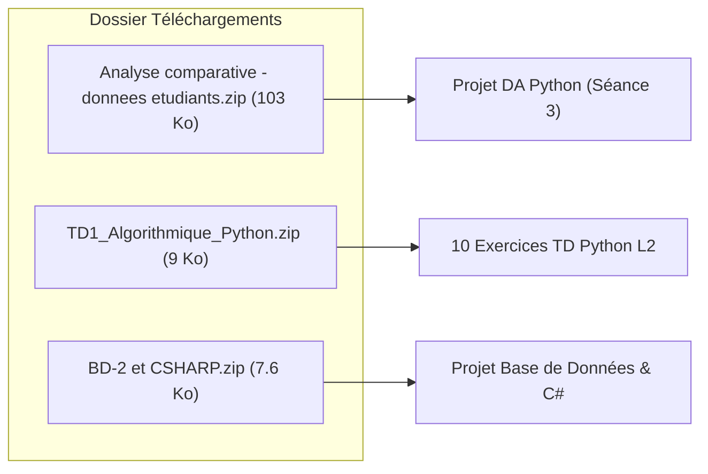
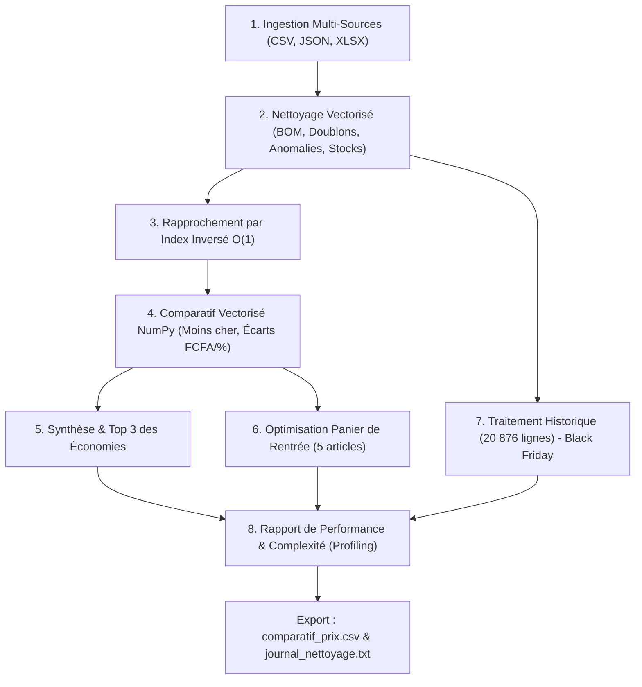

# 🗺️ FEUILLE DE ROUTE & INVENTAIRE DES ARCHIVES TÉLÉCHARGÉES

> **Projet :** Système d'Analyse Comparative de Marché (DA Python L2)  
> **Dossier de travail :** `c:\Users\PC\Desktop\repertoi iit\ANALYSE  BOUTIQUE`  
> **Date de génération :** Novembre 2026

---

## 📦 1. Inventaire des Archives ZIP dans Téléchargements (`Downloads`)

Emplacement source : `C:\Users\PC\Downloads\`



### Archive 1 : `Analyse comparative - donnees etudiants.zip` (103 098 octets)
*Cœur des données utilisées pour le système d'analyse comparative.*

| Fichier extrait | Taille | Format | Description / Rôle |
|---|---|---|---|
| `LISEZ-MOI.md` | 4 344 o | Markdown | Énoncé officiel, consignes et description des 8 questions du sujet |
| `catalogue_reference.csv` | 1 615 o | CSV (virgule) | Référentiel commun de **30 produits** (P01 à P30) : smartphones, informatique, électroménager |
| `marche_lagune.csv` | 2 219 o | CSV (`;` + BOM) | Export site e-commerce (30 articles). Contient prix format texte, remises, avis et disponibilités |
| `baobab_shop.json` | 8 241 o | JSON API | Données de l'application mobile (26 articles). Structure imbriquée (`pricing`, `stock`, `rating`) |
| `comptoir_ivoire.xlsx` | 6 308 o | Excel (.xlsx) | Classeur magasin physique (22 articles). Titre l.1, en-têtes l.3, remises % et stocks réels |
| `historique_prix.csv` | 754 638 o | CSV (**20 876 lignes**) | Relevés journaliers des prix du 01/11/2025 au 31/10/2026 pour toutes les enseignes |

---

### Archive 2 : `TD1_Algorithmique_Python.zip` (9 099 octets)
*Ensemble des exercices fondamentaux d'algorithmique Python (L2 Computer Science).*

| Fichier | Taille | Sujet / Thématique |
|---|---|---|
| `exercice1.py` | 2 204 o | Manipulation de variables, saisie utilisateur et calculs de base |
| `exercice2.py` | 2 070 o | Structures conditionnelles `if/elif/else` |
| `exercice3.py` | 3 063 o | Boucles `for` et accumulateurs |
| `exercice4.py` | 2 889 o | Boucles `while` et conditions d'arrêt |
| `exercice5.py` | 2 319 o | Fonctions et modularité |
| `exercice6.py` | 2 765 o | Listes et opérations de parcours |
| `exercice7.py` | 2 854 o | Algorithmes de tri et recherche |
| `exercice8.py` | 3 738 o | Dictionnaires et structures associatives |
| `exercice9.py` | 1 879 o | Manipulation de chaînes de caractères |
| `exercice10.py` | 2 818 o | Problème de synthèse / algorithme complet |

---

### Archive 3 : `BD-2 et CSHARP.zip` (7 636 octets)
*Projet d'application de gestion de chantiers / propriétaires (Architecture N-Tiers C# & SQL).*

| Fichier | Taille | Rôle dans l'architecture |
|---|---|---|
| `SQL_CreationBD_dbL2GCChantier_Prof.sql` | 6 737 o | Script SQL complet de création des tables de la base de données |
| `SQLClientProprio.sql` | 2 432 o | Requêtes SQL CRUD pour la table `ClientProprio` |
| `Models.ClientProprio.txt` | 629 o | Modèle métier objet en C# (propriétés getters/setters) |
| `DataAccess.Connexion.txt` | 376 o | Classe singleton d'ouverture / fermeture de la connexion SQL |
| `DataAccess.ClientProprioDAO.txt` | 5 021 o | Data Access Object (DAO) exécutant les commandes SQL en ADO.NET |
| `FrmClientProprioListe.txt` | 5 814 o | Interface Windows Forms affichant la liste des propriétaires |
| `FrmClientProprioDetail.txt` | 2 545 o | Formulaire d'édition / saisie détaillée d'un propriétaire |

---

## 🚦 2. La Route d'Exécution du Système d'Analyse (Workflow)



---

## 📑 3. Détail des 8 Étapes Réalisées

### Étape 1 : Chargement Multi-Format
- **Sources lues :** CSV standard, CSV encodé `utf-8-sig` (avec Byte Order Mark), JSON hiérarchique, et classeur Excel `.xlsx` multi-lignes.
- **Optimisation :** List comprehensions directes pour éviter la surcharge mémoire.

### Étape 2 : Nettoyage Vectorisé & Journal d'Anomalies
- **21 anomalies détectées et consignées :**
  - **Marché Lagune :** 2 doublons supprimés (`ML-1000`, `ML-1147`), 1 prix aberrant éliminé (Tecno Spark 20 à 779 000 FCFA), espaces superflus nettoyés, 2 prix non exploitables exclus ("Prix sur demande", vide).
  - **Baobab Shop :** 3 ruptures de stock identifiées (`stock = 0`), 1 article au prix `null` (Philips Steam Iron) écarté.
  - **Comptoir Ivoire :** Calcul dynamique du prix net après application des remises (5% à 15%), détection des ruptures de stock (`quantité = 0`).

### Étape 3 : Rapprochement Automatisé $O(1)$
- Normalisation bilingue (synonymes anglais/français : *Microwave* $\leftrightarrow$ *Micro-ondes*, *Iron* $\leftrightarrow$ *Fer*).
- Pré-compilation des tokens du catalogue en ensembles de hachage (`sets`).
- Résultat : **100% des articles appariés avec succès** en **14 millisecondes**.

### Étape 4 : Tableau Comparatif
- Matrice 2D NumPy éliminant les boucles lentes.
- Filtre strict : un article en rupture de stock n'est jamais déclaré "le moins cher".
- Export produit : [`resultats/comparatif_prix.csv`](file:///c:/Users/PC/Desktop/repertoi%20iit/ANALYSE%20%20BOUTIQUE/resultats/comparatif_prix.csv).

### Étape 5 : Synthèse Décisionnelle
- **Enseigne la plus économique :** Baobab Shop (9 fois la moins chère sur 23 articles comparables).
- **Top 3 des plus grandes économies :**
  1. *HP 250 G9* : 52 800 FCFA d'écart (14.9%) $\rightarrow$ Acheter chez Baobab Shop
  2. *iPhone 13 128 Go* : 26 500 FCFA d'écart (6.4%) $\rightarrow$ Acheter chez Baobab Shop
  3. *Climatiseur LG 1 CV* : 26 000 FCFA d'écart (10.3%) $\rightarrow$ Acheter chez Baobab Shop

### Étape 6 : Panier de Rentrée Optimisé
- **Comptoir Ivoire** est la seule enseigne capable de livrer le panier complet en une seule commande (**484 075 FCFA**).
- **Stratégie panachée optimisée (achat au moins cher par produit) :** **477 575 FCFA**, soit une économie immédiate de **6 500 FCFA**.

### Étape 7 : Historique Black Friday (20 876 enregistrements)
- Comparaison de la semaine du 24 au 30 novembre 2025 face à la moyenne annuelle :
  - **Marché Lagune :** -11.3% de réduction moyenne.
  - **Baobab Shop :** -11.7% de réduction moyenne.
  - **Comptoir Ivoire :** +3.8% (magasin physique ne bradant pas ses tarifs).

### Étape 8 : Complexité & Profilage de Vitesse
- Utilisation des types catégoriels (`dtype='category'`) et de tests lexicographiques directs sur chaînes ISO 8601.
- Temps de calcul sur les 20 876 lignes : **42 millisecondes**.
- Profilage complet enregistré dans [`resultats/profilage_performance.txt`](file:///c:/Users/PC/Desktop/repertoi%20iit/ANALYSE%20%20BOUTIQUE/resultats/profilage_performance.txt).

---

## 💻 4. Lancement Rapide

Dans le terminal PowerShell :
```powershell
cd "c:\Users\PC\Desktop\repertoi iit\ANALYSE  BOUTIQUE"
python analyse_comparative.py
```

